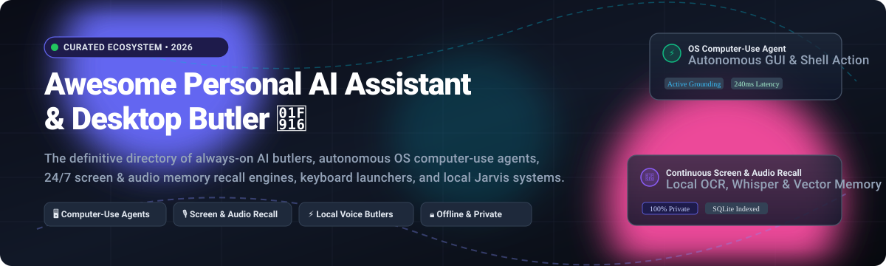
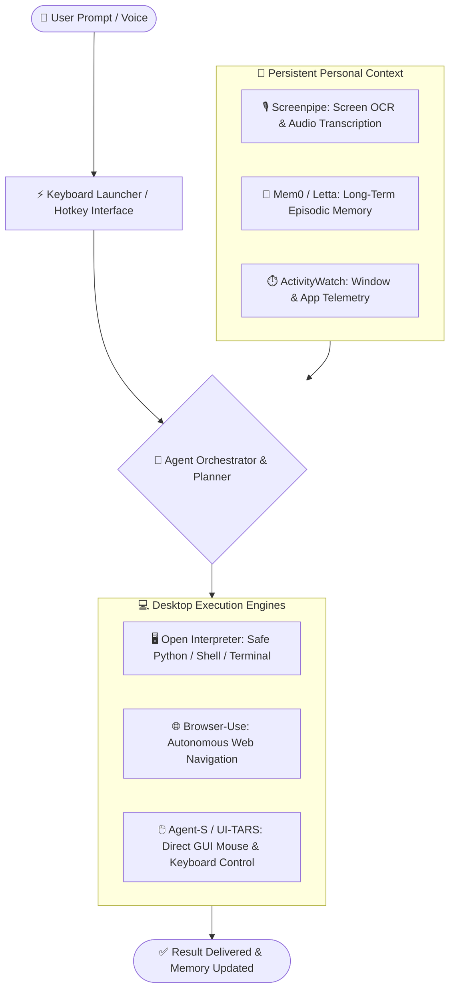

# 🤖 Awesome Personal AI Assistant & Desktop Butler Ecosystem 🎩✨

**A carefully curated directory of industry-leading SaaS platforms and powerful open-source repositories for always-on Personal AI Assistants, Desktop Butlers, OS-Level Computer-Use Agents, Screen & Audio Memory Recall, and Local Jarvis Voice Companions.** 🚀

---

## 📑 Table of Contents
- [🌐 Sector Overview & Market Dynamics](#-sector-overview--market-dynamics)
- [💼 SaaS & Hosted Personal AI Butlers](#-saas--hosted-personal-ai-butlers)
- [💻 Open-Source GitHub Projects](#-open-source-github-projects)
  - [⭐ Top Tier Star Rankings](#-top-tier-star-rankings)
  - [🛠️ Deep-Dive Open Source Profiles](#️-deep-dive-open-source-profiles)
- [🧩 Architectural Blueprint: Building a Sovereign Butler](#-architectural-blueprint-building-a-sovereign-butler)
- [💖 Support & Sponsorship](#-support--sponsorship)
- [📈 Star History](#-star-history)
- [🤝 How to Contribute](#-how-to-contribute)
- [🛡️ Security & Privacy Disclaimer](#️-security--privacy-disclaimer)

---

## 🌐 Sector Overview & Market Dynamics

The global **Personal AI Assistant and Autonomous Agent** market is valued at approximately **$7.1B – $12.1B in 2026** and projected to surge past **$26B to $114B by the early 2030s** at an aggressive compound annual growth rate (CAGR) exceeding **30%–34%**. 

The sector exhibits a **moderately fragmented and bimodal market structure**:
- **Trillion-Dollar Ecosystem Gatekeepers:** Hyperscalers (Apple Intelligence, Microsoft Copilot) possess captive OS-level distribution on millions of personal computers and smartphones.
- **High-Velocity Vertical Challengers:** Focused startups and agile open-source engines dominate high-leverage sub-domains—specifically continuous multimodal screen/audio recall, keyboard-first desktop launchers, and sovereign local-first autonomous computer-use agents. Rather than a singular "winner-take-all" outcome, users increasingly combine unified OS intelligence with sovereign, modular desktop copilots tailored to their explicit privacy and workflow requirements.

---

## 💼 SaaS & Hosted Personal AI Butlers

| Rank | 🏢 Product | 💰 Starting Pricing | 🎁 Free Tier Limit | 📊 Company Size / Valuation / Revenue | 📝 Description |
|:---:|:---|:---|:---|:---|:---|
| 1 | **[Apple Intelligence](https://apple.com)** | **$0** (Integrated into eligible Apple Hardware: M-Series Mac, iPhone 15 Pro+, A17 Pro+ / M-chips) | **Free Forever** for all compatible device owners (on-device local models + free Private Cloud Compute quota) | **~$3.4 Trillion Market Cap** ($391B+ Annual Revenue) | System-wide personal intelligence embedded across macOS, iOS, and iPadOS featuring on-device context awareness, Siri upgrades, and Private Cloud Compute. 🍏 |
| 2 | **[Microsoft Copilot (Windows & M365)](https://microsoft.com)** | **$20.00 / user / month** (Copilot Pro) / **$30.00 / user / month** (Copilot for Microsoft 365) | **Free Forever** on Windows/Web/Mobile (Standard chat & web queries, ~15 daily image boosts, dynamic fair-use capacity limits, no desktop Office app embedding) | **~$3.1 Trillion Market Cap** ($245B+ Annual Revenue) | OS-integrated companion providing system-level Windows toggles, screen vision (`Copilot Vision`), document synthesis, and automated productivity. 🪟 |
| 3 | **[Adept (ACT / Enterprise Agents)](https://adept.ai)** | **$20.00 / user / month** (Enterprise Pilot Seat baseline) | **7-day free trial** upon approved developer request (Limited to 50 agent execution steps/eval runs) | **$1.0+ Billion Peak Valuation** (Reverse acqui-hired/licensed by Amazon in $400M+ strategic talent agreement) | Agent platform engineered to interact directly with software interfaces, web browsers, and enterprise desktop workflows using natural language. 🤖 |
| 4 | **[Limitless AI](https://limitless.ai)** *(formerly Rewind AI)* | **$19.00 / month** (billed annually at $228/year or $29/mo monthly) | **Free Forever** plan including **1,200 minutes (20 hours)** of audio transcription per month, automated meeting notes, and searchable personal recall | **~$350 Million Peak Valuation** (~$34.3M VC raised from a16z, Sam Altman; acquired by Meta) | Personalized AI memory capturing meetings, screen activity, and wearable audio to power searchable recall and automated action items. 🧠 |
| 5 | **[MindOS](https://mindos.com)** *(by Mindverse)* | **$20.00 / month** (Standard Starter tier) | **Free Forever** plan with **100 credits/month**, access to 3 custom AI Geniuses/Agents, and basic knowledge base ingestion | **~$250 Million – $500 Million Valuation** ($50M+ Series A led by Meituan) | Cloud AI agent and digital twin workspace allowing individuals and teams to deploy autonomous assistants connected to personal knowledge and APIs. 🌐 |
| 6 | **[Raycast AI](https://raycast.com)** | **$8.00 / month** (billed annually at $96/year or $10/mo monthly for Pro) | **Free Forever Launcher** (Blazing launcher, window manager, 3-month clipboard history, 5 quick notes; AI features include a limited trial allotment of ~50 AI messages) | **~$100 Million – $250 Million Valuation** ($47.8M VC raised, $30M Series B led by Atomico) | Blazing-fast macOS and Windows productivity launcher integrating multi-model AI chat, quick actions, custom script commands, and workflows. ⚡ |
| 7 | **[Lindy](https://lindy.ai)** | **$29.99 / user / month** (Plus tier with 3,000 monthly credits) | **7-day free trial** with **$50 free credits** (~500–3,000 autonomous agent workflow tasks, no credit card required upfront) | **~$50 Million Total VC Raised** (~$5.2M ARR estimate; backed by Battery Ventures & Menlo Ventures) | No-code personal AI assistant platform enabling users to build autonomous "Lindies" for email triage, calendar scheduling, meeting notes, and CRM updates. 📅 |
| 8 | **[Personal.ai](https://personal.ai)** *(Human AI Labs)* | **$40.00 / month** (Launch Plan for continuous individual AI memory training) | **Free Forever (Ignite Plan)** with everyday Copilot messaging, starter sync integrations, and personal knowledge base exploration | **~$30 Million Valuation Cap** (~$21.9M total funding raised via institutional & community rounds) | Personal language model platform trained on an individual's own memories, messages, and documents for hyper-personalized recall and drafting. 👥 |
| 9 | **[Taskade AI Agents (Butler)](https://taskade.com)** | **$8.00 / month** (billed annually for Pro or $10/mo monthly) | **Free Forever Plan** for up to 2 workspace members, 1 custom AI agent, 3 Genesis AI app builds, and 10 automation runs per billing cycle | **~$1.6 Million – $2.0 Million ARR** (~$5.2M total funding raised; Y Combinator backed) | Collaborative workspace featuring autonomous AI agents that plan tasks, conduct background research, and automate team workflows. 📋 |

---

## 💻 Open-Source GitHub Projects

Explore the most capable open-source software repositories for building, deploying, and customizing your own sovereign desktop AI butler.

### ⭐ Top Tier Star Rankings

*All repositories are actively tracked and sorted in descending order by GitHub stargazers count:*

| # | 🌟 Project & Stargazers | 🏷️ Primary Domain | 💡 Key Architecture Highlights |
|:---:|:---|:---|:---|
| 1 | **[browser-use/browser-use](https://github.com/browser-use/browser-use)**    | Browser Automation Agent | Connects personal AI agents directly to web browsers for autonomous booking, research, scraping, and form filling. 🌐 |
| 2 | **[OpenHands/OpenHands](https://github.com/OpenHands/OpenHands)**    | Autonomous Software Butler | Autonomous software engineering, CLI execution, terminal commands, and browser-driven multi-step automation. 💻 |
| 3 | **[home-assistant/core](https://github.com/home-assistant/core)**    | Smart Home & Voice Butler | Local-first home automation backbone featuring `Assist`, offline voice wake-words (Wyoming), and intent pipelines. 🏡 |
| 4 | **[mem0ai/mem0](https://github.com/mem0ai/mem0)**    | Agent Long-Term Memory | Drop-in universal memory layer giving personal AI assistants persistent, self-evolving recall across sessions and apps. 🧠 |
| 5 | **[openinterpreter/openinterpreter](https://github.com/openinterpreter/openinterpreter)**    | OS Computer-Use Interface | Natural-language interface for local computers enabling LLMs to safely execute Python, Bash, AppleScript, and GUI actions. 🖥️ |
| 6 | **[Mintplex-Labs/anything-llm](https://github.com/Mintplex-Labs/anything-llm)**    | Desktop Knowledge Copilot | All-in-one local desktop AI application with multi-user RAG, document embedding, custom agents, and native MCP support. 📚 |
| 7 | **[mudler/LocalAI](https://github.com/mudler/LocalAI)**    | Local Multi-Model Engine | Drop-in OpenAI-compatible local AI backend for LLMs, vision, audio transcription (Whisper), and TTS without cloud reliance. ⚡ |
| 8 | **[janhq/jan](https://github.com/janhq/jan)**    | Offline-First Desktop Companion | 100% offline desktop ChatGPT alternative running local GGUF models via llama.cpp with customizable personal assistant extensions. 🔒 |
| 9 | **[bytedance/UI-TARS-desktop](https://github.com/bytedance/UI-TARS-desktop)**    | Multimodal GUI Agent | Native desktop GUI agent framework powered by vision-language models for cross-platform system control and navigation. 🎯 |
| 10 | **[khoj-ai/khoj](https://github.com/khoj-ai/khoj)**    | Personal Second-Brain Copilot | Self-hosted AI second brain indexing personal Markdown notes, PDFs, code, and chat history across Desktop, Emacs, and WhatsApp. 🔍 |
| 11 | **[letta-ai/letta](https://github.com/letta-ai/letta)**    | Stateful Memory Platform | Framework for building stateful, perpetual agents (formerly MemGPT) that edit and manage their own infinite memory hierarchies. 🗂️ |
| 12 | **[screenpipe/screenpipe](https://github.com/screenpipe/screenpipe)**    | Continuous Screen & Audio Recall | 24/7 continuous local screen OCR and mic/audio capture engine storing structured events in SQLite for AI agent queries. 🎙️ |
| 13 | **[ActivityWatch/activitywatch](https://github.com/ActivityWatch/activitywatch)**    | Automated Activity Tracker | Privacy-first automated desktop telemetry tracking active windows, applications, and browser tabs for daily AI digests. ⏱️ |
| 14 | **[leon-ai/leon](https://github.com/leon-ai/leon)**    | Modular Voice & Text Butler | Open-source personal voice/text assistant running on your personal server with modular skills and offline speech pipelines. 🗣️ |
| 15 | **[Flow-Launcher/Flow.Launcher](https://github.com/Flow-Launcher/Flow.Launcher)**    | Extensible Windows Launcher | Quick-file search and productivity launcher for Windows featuring community plugins for local LLMs and shell automation. 🪟 |
| 16 | **[simular-ai/Agent-S](https://github.com/simular-ai/Agent-S)**    | Hierarchical Computer Agent | Open-source GUI computer-use agent performing complex desktop tasks through multimodal perception and sub-goal planning. 🦾 |
| 17 | **[vicinaehq/vicinae](https://github.com/vicinaehq/vicinae)**    | Native C++/Qt Desktop Launcher | Ultra-responsive desktop launcher for Linux with full Raycast extension compatibility and native local AI plugins. 🐧 |
| 18 | **[OthersideAI/self-operating-computer](https://github.com/OthersideAI/self-operating-computer)**    | Multimodal Mouse/Keyboard Agent | Framework empowering vision models (GPT-4V, Claude 3.5 Computer Use) to directly drive mouse movements and keyboard inputs. 🖱️ |
| 19 | **[reorproject/reor](https://github.com/reorproject/reor)**    | Local AI Knowledge Base | Self-organizing local-first AI markdown note-taking app that automatically interconnects related ideas using local embeddings. 📝 |
| 20 | **[albertlauncher/albert](https://github.com/albertlauncher/albert)**    | C++ Keyboard Launcher | Fast, extensible C++ keyboard launcher for Linux with deep system integration, Python extensions, and web/AI endpoints. ⌨️ |
| 21 | **[Ulauncher/Ulauncher](https://github.com/Ulauncher/Ulauncher)**    | Python Application Launcher | Application launcher for Linux desktops with instant fuzzy search, custom shortcuts, and community extension scripts. ⚡ |
| 22 | **[xlang-ai/OSWorld](https://github.com/xlang-ai/OSWorld)**    | Real OS Agent Benchmark | Comprehensive real-world desktop environment benchmarking multimodal computer-use agents across Ubuntu, Windows, and macOS. 🧪 |
| 23 | **[showlab/computer_use_ootb](https://github.com/showlab/computer_use_ootb)**    | Out-Of-The-Box GUI Companion | Ready-to-use GUI desktop agent interface for Windows and macOS with built-in grounding visualizers and trajectory recording. 📦 |

---

### 🛠️ Deep-Dive Open Source Profiles

- **Continuous 24/7 Context Layer:**
  - **[Screenpipe](https://github.com/screenpipe/screenpipe)** captures your monitor screens via OCR and audio through local Whisper models, indexing everything into SQLite so your AI butler knows what you worked on 2 hours ago.
  - **[ActivityWatch](https://github.com/ActivityWatch/activitywatch)** logs active application windows, documents, and browsing durations without sending a single byte to external servers.
- **Autonomous OS & Web Action Layer:**
  - **[Open Interpreter](https://github.com/openinterpreter/openinterpreter)** acts as a natural-language bash/powershell runner that installs packages, modifies configuration files, and cleans up folders on command.
  - **[Browser-Use](https://github.com/browser-use/browser-use)** spins up headless or visual Chromium instances to conduct research, book flights, or order groceries automatically.
  - **[Agent-S](https://github.com/simular-ai/Agent-S)** and **[UI-TARS](https://github.com/bytedance/UI-TARS-desktop)** observe raw desktop screenshots, ground UI coordinates, and trigger mouse clicks/typing.
- **Persistent Personal Memory Core:**
  - **[Mem0](https://github.com/mem0ai/mem0)** and **[Letta](https://github.com/letta-ai/letta)** provide hierarchical memory abstractions, ensuring your butler remembers your coding preferences, personal relationships, and recurring tasks across weeks.

---

## 🧩 Architectural Blueprint: Building a Sovereign Butler

Want to assemble a completely local, private Jarvis-style desktop butler? You can connect these open-source building blocks:

1. **Perception Engine:** Run **Screenpipe** as a background service for 24/7 screen OCR and microphone capture.
2. **Context Memory:** Route daily summaries into **Mem0** and **Khoj** for semantic search and fast vector retrieval.
3. **Inference Server:** Host your LLM of choice (Llama 3.3, Qwen 2.5, or Mistral) locally via **Ollama** or **LocalAI**.
4. **Execution Layer:** Bind **Open Interpreter** for terminal commands and **Browser-Use** for web interactions.
5. **Hotkey Interface:** Wire commands to global keyboard shortcuts via **Flow Launcher** (Windows), **Raycast / Alfred** (macOS), or **Vicinae** (Linux).

---

## 💖 Support & Sponsorship

Thank you so much for exploring and supporting this curated project! If you find this repository valuable for discovering tools, researching personal AI assistants, or building autonomous desktop butlers, please consider supporting the project:

- ⭐ **Star this repository** to help others discover it and track new releases.
- 🍴 **Fork it** to customize your personal stack and contribute back.
- 📢 **Share it** with friends, colleagues, and AI communities on X, Reddit, and Discord.
- ☕ **Buy me a coffee / Sponsor**: Support ongoing maintenance and curation directly on the [GitHub Sponsors Dashboard](https://github.com/sponsors/ishandutta2007).

---

##  Star History
#

---

## 🤝 How to Contribute

Contributions are warmly encouraged! Help keep this repository the world's most up-to-date and authoritative guide to personal AI assistants:

1. 🍴 **Fork the repository** on GitHub.
2. 🌿 **Create a feature branch:** `git checkout -b feature/add-new-butler`
3. ✍️ **Update `README.md`:** Ensure SaaS products include exact starting prices, free tier limits, and valuation/revenue metrics. For open-source tools, include the standard social star badge and ensure entries are sorted appropriately.
4. 📬 **Submit a Pull Request** with a concise explanation of why the tool belongs here.

---

## 🛡️ Security & Privacy Disclaimer

- Always-on screen/audio recorders (e.g., Screenpipe) and autonomous computer-use agents (e.g., Open Interpreter, Agent-S) hold high system privileges. Run them inside sandboxed containers or virtual machines whenever possible, and keep human-in-the-loop validation active for destructive file or network operations.
- Comply with applicable local recording consent laws and workplace data confidentiality agreements when enabling background microphone capture.

---

**Built with ❤️ for AI researchers, power users, privacy builders, and automation enthusiasts worldwide.**

[⬆ Back to Top](#-awesome-personal-ai-assistant--desktop-butler-ecosystem-)

